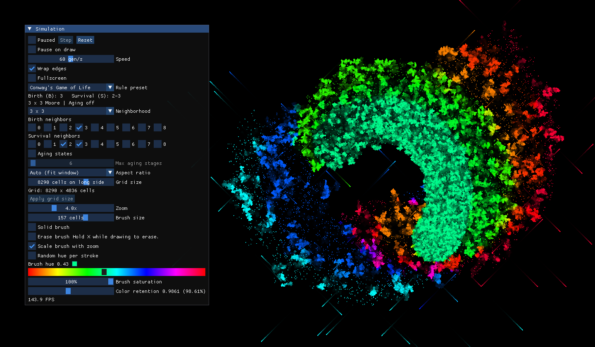

Windows
cmake --build build --config Debug
cmake --build build --config Release

cmake -B build -DCMAKE_BUILD_TYPE=Release
cmake --build build


cmake -S . -B build -G "Visual Studio 17 2022" -A x64
cmake --build build --config Debug


Linux
cmake -S . -B build-linux -G Ninja -DCMAKE_BUILD_TYPE=Debug
cmake --build build-linux

## Running the simulation



Conway's Game of Life on an 8,290 × 4,836 grid. Colors blend where live
populations meet, and dead cells leave trails at 98.61% brightness retention
per generation.

Launch `CellularAutomata` from the build output (`build/bin/Debug` for the
Visual Studio Debug build). CMake copies the SPIR-V shaders into the `shaders`
folder beside the executable. The app requires an SDL GPU backend that
supports SPIR-V, typically Vulkan.

The Simulation panel keeps the FPS counter visible in its header. On mobile,
it stays above the scrolling settings. The panel lets you pause, advance one generation while paused,
toggle edge wrapping or fullscreen, and select the neighbor counts for birth
and survival. Press **Esc** to exit fullscreen. The default is Conway's Game of Life (B3/S23), with two cell
states. **Neighborhood shape** selects Moore (square), Von Neumann (diamond),
Circular (a disk measured between cell centers), or Hexagonal (an axial hex grid
displayed as square cells). **Radius** ranges from one to five cells. The center
cell is excluded, and the panel displays the number of eligible neighbors.
Birth and survival
settings for larger counts are remembered when you switch to a smaller
neighborhood. Turn on **Aging states** to delay rebirth after a cell dies. **Max aging
stages** sets the number of generations spent aging. Aging cells do not count
as live neighbors. Disabling aging makes them eligible for birth on the next
generation. Rule changes apply on the next generation.

**Rule preset** sets the birth and survival counts, aging stages, and
neighborhood together. The panel displays the active rule and shows
**Custom** whenever those settings differ from the named presets.
The menu groups 47 presets into Life-like, Generations, Larger than Life, and Other neighborhoods.
Larger than Life includes nine presets with radii above one across Moore,
Circular, and Hexagonal neighborhoods. Six use rules from
[Golly's Larger-than-Life pattern collection](https://github.com/AlephAlpha/golly/tree/master/Patterns/Larger-than-Life).
Circular Growth is a radius-three disk preset with birth counts 8–10 and
survival counts 7–12.
Presets come from [Cotronei's Life-like rule table](https://www.oldcitypublishing.com/wp-content/uploads/2025/07/JCAv16n3-4p239-310Cotronei.pdf)
and Golly's [QuickLife](https://golly.sourceforge.io/Help/Algorithms/QuickLife.html),
[Generations](https://golly.sourceforge.io/Help/Algorithms/Generations.html),
and [Larger than Life](https://golly.sourceforge.io/Help/Algorithms/Larger_than_Life.html)
rule examples.

Births and survivors inherit the circular mean hue of their live neighbors.
For example, hues on either side of red blend to red. If the neighbors'
hues cancel, a survivor keeps its hue and a birth uses the first live
neighbor's hue. Cells keep their last color as they age and die. Once dead,
they fade according to **Color retention**, the fraction of brightness kept
per generation. The panel shows both the decimal value and its percentage.
The slider gives finer control near 1, where small changes
make trails last much longer. Set it to 0 for immediate fading on the next
dead generation, or to 1 to keep the trail visible. Fading cells do not count
as living neighbors. **Brush saturation** sets the saturation of newly
painted cells from 25% to 100%. Existing cells keep their saturation when
the slider changes. A birth inherits the average saturation of its live
neighbors.

The grid starts empty and running at 4x zoom or closer on narrow screens so
individual cells are visible.
Hold the left mouse button and drag to paint living cells. Hold **X** while
drawing to erase, or toggle **Erase brush**. On mobile web, tap the **Mode**
button to switch between drawing and erasing. Open **Settings** from the toolbar
and swipe the controls to scroll. Tap **Hide UI for 5s** to clear the view for
a screenshot. With a keyboard, press **H** to hide or restore the interface and
**P** to pause or resume. Use one finger to draw or erase, and
two fingers to pinch to zoom or drag to pan. The browser keeps the view
centered and preserves the apparent cell size when you rotate your phone. Use **Aspect ratio** to choose a viewport preset or **Auto (fit window)** to
follow the current window size. Auto is the default. Aspect changes crop the
visible grid while keeping cells square. **Grid size** sets the length of
the longer side from 128 to 3,200 cells on mobile browsers and up to 12,000 cells
on desktop. The browser's WebGL limits can reduce the maximum, and larger grids
require more GPU memory. The other side follows the selected
aspect ratio. **Apply grid size** preserves the overlapping center of the
grid, clears newly added space, and drops any cells outside the new edges.
**Brush size**
sets the circular brush diameter on a logarithmic scale, from one cell up to
one-fifth of the current grid width, rounded down.
The default diameter is 12 cells.
Hold Shift while scrolling over the grid to resize it. The **Scale brush
with zoom** (on by default) keeps the brush's apparent size roughly constant
when zooming, within the brush size limit. Each cell whose center is inside or
on the circle is randomly set alive or dead by default, with an even chance
of either. Turn on **Solid brush** to make every cell in the circle alive.
**Random hue per
stroke** picks a different color for every drag. Turn it off to use **Brush
hue** instead. Scroll over the grid to zoom around the pointer,
or use **Zoom** to zoom around the center. Hold the right mouse button and
drag to pan. Set zoom to 1x to see the entire grid.

Unpause the simulation or use **Step** to advance one generation. **Reset**
clears the grid and keeps the current pause state. Enable **Pause on draw** to stop
automatic generations while painting. Releasing the brush resumes a running
simulation. Use **Speed** to set a target from
1 to 120 generations per second. The actual rate depends on GPU work and how
often the window can present.

## Browser build

[Run Cellular Automata on GitHub Pages](https://umaidmalik.github.io/cellular-automata-sdl/).

Install and activate Emscripten 4.0.20, then run the following from the
repository root with the third-party sources in place.

```sh
emcmake cmake -S . -B build-web -G Ninja -DCMAKE_BUILD_TYPE=Release
cmake --build build-web
python -m http.server 8000 --directory build-web/site
```

Open `http://localhost:8000` in a browser with WebGL 2. The browser build uses
the same update shader and simulation controls as the desktop build.
The GitHub Actions workflow builds pull requests and publishes pushes to
`main` when GitHub Pages is configured to use GitHub Actions.
